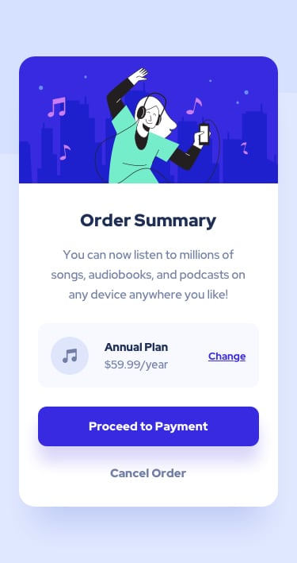
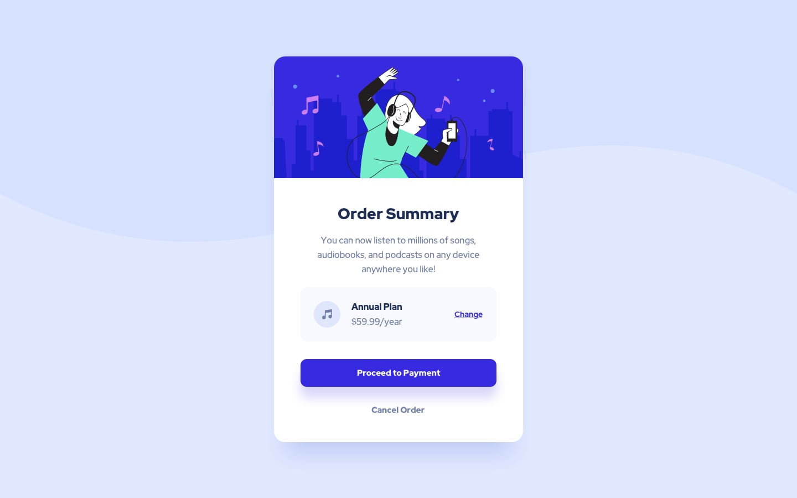

# Resumen de pedido

Maqueta una tarjeta de resumen de pedido siguiendo las referencias. Conserva los textos en inglés y utiliza los recursos de la carpeta **images**.

## Tu tarea

1. Abre **index.html** con Live Server.
2. Organiza el contenido con una ilustración, un título principal, una descripción, el resumen del plan y las acciones de pago y cancelación.
3. Escribe los estilos en **style.css**.
4. Utiliza Flexbox para alinear el icono, la información del plan y el enlace **Change**.
5. Adapta la tarjeta al ancho disponible y comprueba que se lee sin desplazamiento horizontal.

## Diseño esperado

### Diseño móvil



### Diseño ampliado



El resultado es aproximado. Ajusta los tamaños y espacios observando las referencias.

## Hoja de estilos

El HTML ya enlaza el archivo **style.css**, situado en la misma carpeta:

```html
<link rel="stylesheet" href="style.css">
```

## Colores de referencia

| Elemento | Color |
| --- | --- |
| Fondo de página | `#e0e8ff` |
| Fondo de tarjeta y texto del botón principal | `#ffffff` |
| Fondo del resumen del plan | `#f5f7ff` |
| Botón principal y enlace Change | `#3829e0` |
| Descripción, precio y cancelación | `#7280a7` |
| Título y nombre del plan | `#1f2f56` |

## Tipografía

Utiliza **Red Hat Display**, con grosores 500, 700 y 900. La fuente ya está enlazada en el HTML.

## Recursos

- **images/illustration-hero.svg**: ilustración principal.
- **images/icon-music.svg**: icono del plan.
- **images/pattern-background-desktop.svg** y **images/pattern-background-mobile.svg**: fondos decorativos.

## Comprueba tu trabajo

- La tarjeta está centrada y se adapta a ventanas estrechas y amplias.
- El resumen del plan mantiene sus elementos alineados.
- La ilustración se adapta al ancho de la tarjeta.
- El título, el texto y las acciones se distinguen con claridad.

Ejercicio basado en el reto **Order summary card** de Frontend Mentor.
